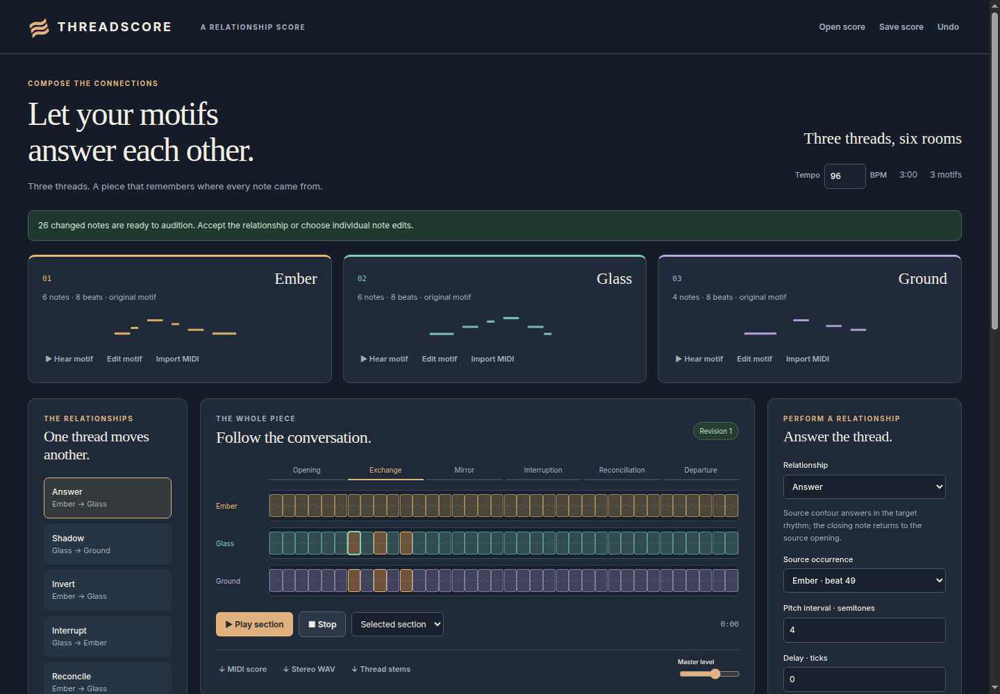

# THREADSCORE

Compose the connections between persistent musical motifs. THREADSCORE is a local composition instrument with named source motifs, editable occurrences, an explicit relationship score, note ancestry, auditionable proposals, and MIDI, WAV, stem, and editable-project export.

This private implementation follows selected concept 6 in [HAMON’s project selection](https://github.com/Jacob-Met/hamon/issues/1631#issuecomment-6431104215) and the [retained team’s source claim](https://github.com/Jacob-Met/hamon/issues/1631#issuecomment-6431227633). The current instrument mechanics have passed actual browser receiving. **Live NVIDIA-model generation on Nebius, subjective musical quality, and improvement over independent clip editing remain unqualified.** The optional model path is disabled by default.



## Run locally

Use Node.js 22 or later and a modern browser with Web Audio and module-worker support. There are no runtime package dependencies and no installation step.

```sh
npm start
```

Open [http://127.0.0.1:4173](http://127.0.0.1:4173). The server binds to loopback. Opening the application makes no model call and sends no imported music to a service. Save your work with **Save score**; there is no automatic persistence between page loads.

The included original composition, **Three threads, six rooms**, is three minutes at 96 BPM. Ember, Glass, and Ground each retain a source motif across six sections. Its six relationships compile 576 notes, of which 573 are audible; interruptions retain the identities of muted notes. One Glass note is pinned to demonstrate preservation through a relationship change.

## A first session

1. Use **Hear motif** to audition each source, then select a section and play it. Choose the whole-piece range to hear the full arrangement.
2. Select **Answer**, change the pitch interval from 3 to 4 semitones, and choose **Preview the change**. The original demo produces 26 changed notes across the answer and its downstream shadow.
3. Use **Before** and **Proposed** to compare actual audio. Inspect changed notes and ancestry. Accept the relationship to change the graph, or select individual notes to accept explicit occurrence edits. A partial acceptance is rejected if it would also change unselected dependent notes.
4. Click an occurrence in the arrangement and select a piano-roll note. Edit its pitch, timing, or velocity, or pin its performed values. Switch to **Edit source motif** when the change should affect every occurrence sharing that source.
5. Save the editable score, then export MIDI or the audio you need. Reopen the saved score to continue editing.

Changing a relationship control invalidates its old preview and stops that preview’s playback. A rejected change preserves the project. Undo restores earlier project content as a new revision.

## Relationship score

Each relation addresses named target occurrences in the same section as its source. The compiler evaluates occurrence dependencies, rejects cycles and invalid pitches or timing, and preserves note identities.

| Relationship | Performed change |
| --- | --- |
| Answer | Maps source contour onto target rhythm, with interval, delay, and velocity scaling; its ending returns to the source opening. |
| Shadow | Follows source pitch, rhythm, duration, and dynamics with interval, delay, and velocity scaling. |
| Invert | Reflects source pitches around a MIDI pitch axis while retaining target rhythm. |
| Interrupt | Uses a selected source onset to place a gap, shortening crossing notes and muting notes that start inside it. |
| Reconcile | Moves target pitches toward source pitch classes and dynamics toward the source mean, controlled by strength. |
| Gradual divergence | Progressively changes source influence, transposition, and timing drift through the addressed phrase. |

Intervals are semitones; timing controls explicitly identify ticks or beats. Preview every consequential change. These operations are compositional tools, not claims that a particular result is musically successful.

## Sources, occurrence edits, and pins

A **source motif** is shared material. Adding, deleting, or editing a source note recompiles its occurrences and their downstream relationships. Source-note insertion chooses an available rhythmic gap and selects the new note only after a successful compile.

An **occurrence edit** stores an explicit performed note at one occurrence. **Release accepted edit** restores the note’s graph-derived behavior. A **pin** preserves that note’s performed pitch, timing, velocity, mute state, and recorded ancestry through later edits. Unpin before changing the pinned note itself.

The saved project contains source motifs, occurrences, relationships, locks, explicit edits and their ancestry, plus any accepted model receipts. Compiled score ancestry is recomputed when reopening. A SHA-256 checksum detects changes to the saved project; it is not a signature or proof of an imported receipt’s authenticity. Imported model receipts are always marked unverified, including all repair-attempt receipts.

## Import a MIDI motif

Choose **Import MIDI**, select a logical track and beat window, and select the thread whose source should be replaced. The selected window must fit the existing motif, preserve exact tick timing after conversion to the project’s 480 PPQ, and contain 1–256 complete notes. Boundary-crossing notes are rejected. The source motif’s existing length and remaining rest space are preserved.

Import is deliberately **note-only**. File name, content hash, track, source timing, tempo map, and import window are recorded as provenance. Source tempo, meter, pedal, expression, pitch bend, and instruments do not become performance instructions. Format 0 and 1 files are supported; format 2 and SMPTE timing are rejected. Release all pins and explicit edits addressing the replaced shared motif before importing.

## Export and sound

- **MIDI score** exports each thread on its assigned channel and program, with the complete timeline and muted notes omitted. Events use one explicit tempo and preserve exact note ticks.
- **Stereo WAV** renders the complete score as 48 kHz, 16-bit stereo PCM.
- **Thread stems** exports one WAV per thread in a ZIP. All stems share the same origin, duration, gain, and rendering clock, so they can be aligned and summed without individual normalization.
- **Save score** exports the editable relationship project as JSON.

The built-in audio renderer uses original additive preview voices. Program numbers act as timbre hints; this is not a sampled General MIDI instrument library. Use exported MIDI with your own instruments when timbre matters. Technical audio checks establish valid rendering and alignment, not artistic quality or a listening assessment.

## Optional model synthesis

The server-side adapter is intended to use an NVIDIA model on Nebius to propose a typed composition program. It only activates when `THREADSCORE_ENABLE_MODEL=1` and an existing maintained `NEBIUS_API_KEY` are present in the server environment. `THREADSCORE_MODEL` can select an approved NVIDIA identifier. The default candidate is `nvidia/Nemotron-3_5-Lightning`; account availability and live behavior have not been qualified.

The browser does not accept credentials, endpoint changes, or model overrides. A model request sends bounded symbolic project context and the user’s explicit instruction, never audio. A proposal must compile before preview and must be explicitly accepted. One compiler-guided repair is allowed after a confirmed invalid program. Unknown transport outcomes are not retried. Confirmed attempts retain separate receipts; unresolved attempts are not assigned invented usage or cost.

Tests inject a fake provider and do not establish live model performance. See [verification and remaining qualification](docs/verification.md) before relying on this path.

## Practical bounds

MIDI inputs are limited to 4 MiB and editable projects to 2 MiB. A project can contain up to 64 motifs, 16 threads, 128 sections, 1,024 occurrences, 128 relations, and 20,000 compiled notes. Shared ancestry work has inspection and byte bounds in addition to output-size limits.

Audio rendering is limited to ten minutes per operation, with preflight limits of 128 MiB for the PCM allocation and 128 MiB for a planned stem ZIP. These are allocation-category limits, not a claim about total process memory. An oversized request is rejected before the large allocation. Model context is limited to 96 KiB and provider responses to 64 KiB. The three-minute demo fits these bounds.

## Verify and package

```sh
npm test
THREADSCORE_CHROME=/path/to/google-chrome npm run test:browser
npm run package
```

Browser verification launches its own loopback server and sandboxed Chrome profile, exercises actual editing and playback controls, receives downloads, and captures desktop/mobile screenshots. It does not call a model or relax Chrome’s autoplay policy. Test recordings and downloads go under ignored `artifacts/`.

Packaging writes `dist/threadscore-0.1.0.zip` with source, tests, tools, documentation, screenshots, and a SHA-256 file manifest. Credentials, imported inputs, local artifacts, Git metadata, and dependencies are excluded. Extract the archive, enter its `threadscore` directory, and use the same run commands. The manifest records the source commit and whether the source was dirty; verify those values when receiving a package.

## Context and next evidence

[Music SketchNet](https://arxiv.org/abs/2008.01291) and [Coconet](https://magenta.tensorflow.org/coconet) provide relevant prior work on symbolic music interaction and completion. THREADSCORE’s current implementation uses deterministic relationship compilation; it does not claim novelty from those comparisons or a measured advantage over them.

The remaining outcome work is real authorized NVIDIA/Nebius synthesis against held-out musical requests, direct listening review, and a fair independent-clip comparison with actual composer evidence. Private source integration and packaging do not complete those obligations.
